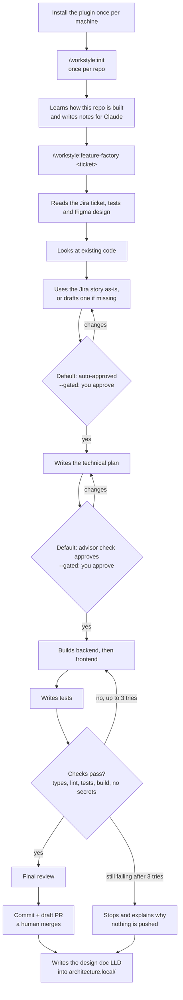

# How workstyle works (plain English)

workstyle is your own set of Claude Code habits, packed so every repo gets them.
You install it once per machine, set up each repo once, then ask it to build features.

## The big picture

## The commands

| Command | When | What it does |
|---|---|---|
| `/workstyle:init` | Once per repo | Indexes the code, finds its layers and test commands, writes notes into `coding-patterns.local/` and `CLAUDE.md`. |
| `/workstyle:feature-factory <ticket>` | Per feature | The full pipeline above, hands-off (the default). Anything risky stops the run instead of guessing. |
| `/workstyle:feature-factory --gated <ticket>` | Per feature, with you | Same pipeline, but asks you to approve the story and the plan. |
| `/workstyle:lld` | Any time | Writes a design doc for work you just did into `architecture.local/`. |
| `/workstyle:review-learnings` | Now and then | Shows what the plugin learned from your corrections, so you can keep or drop each one. |
| `scripts/factory-run.sh "<ticket>"` | Unattended | Runs the default pipeline with nobody at the keyboard; its exit code says done (0), handed off (3) or never started (4). |

## What happens on its own

- **Checks can't be skipped.** A hook (not Claude's judgement) blocks "done" while types, lint, tests or the build fail.
- **It works on its own branch** (`ff/<ticket>`) and never touches a dirty working tree.
- **It never merges.** The best case is a draft PR that you review and merge.
- **It remembers corrections.** When you correct it, it saves a short note; you decide which become permanent rules.
- **It can't do anything irreversible.** Force-push, pushing to the main branch, deleting history, deploying and publishing are blocked by a hook.
- **Everything it writes for itself stays local.** `.workstyle/`, `coding-patterns.local/`, `architecture.local/` and `.codegraph/` are never committed.

## When it stops instead of guessing (default mode)

- The plan needs a big design choice that is hard to undo.
- The advisor check says "block".
- A bug fix whose test can't reproduce the bug first.
- The change is bigger than the repo's size limit.
- Checks still fail after 3 build attempts.

In each case it saves the work locally, writes `failure.md` with the reason, and pushes nothing.

## Where to look afterwards

| Folder | What's in it |
|---|---|
| `.workstyle/runs/<run>/` | Every step's output, the check report, `failure.md` if it stopped |
| `architecture.local/` | One design doc (LLD) per task, plus an index `README.md` |
| `coding-patterns.local/` | How this repo is built, one file per layer |
| The draft PR | Story, plan summary, check results, known issues |
